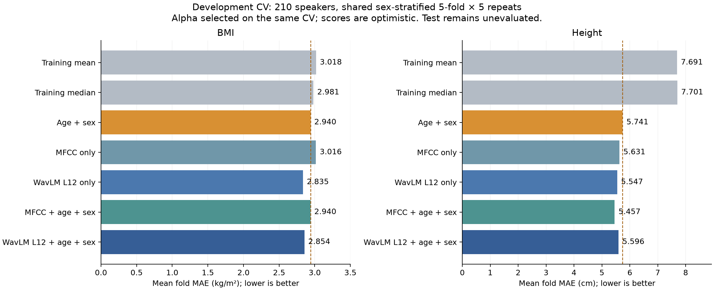

# 固定第12層：BMI／身高基準比較

這一輪使用相同210位development說話者、保存的性別分層5折×5次CV。數字是各25折MAE的平均，越低越好；四個語音模型在同一CV上各自選alpha，所以分數有選擇的樂觀偏差，不能當成最終泛化成績。135位test未預測、未計算指標。

| 模型 | BMI MAE（kg/m²） | 身高 MAE（cm） |
|---|---:|---:|
| 訓練折平均值 | 3.018 | 7.691 |
| 訓練折中位數 | 2.981 | 7.701 |
| 年齡＋性別（OLS） | 2.940 | 5.741 |
| MFCC 單獨 | 3.016 | 5.631 |
| WavLM 第12層單獨 | 2.835 | 5.547 |
| MFCC＋年齡＋性別 | 2.940 | 5.457 |
| WavLM 第12層＋年齡＋性別 | 2.854 | 5.596 |

| 目標／語音模型 | alpha | 相對人口基準MAE差 | 勝／平／負（25折） |
|---|---:|---:|---:|
| bmi／MFCC 單獨 | 1000 | +0.076 | 4／0／21 |
| bmi／WavLM 第12層單獨 | 1000 | -0.105 | 18／0／7 |
| bmi／MFCC＋年齡＋性別 | 1e+12 | +0.000 | 0／25／0 |
| bmi／WavLM 第12層＋年齡＋性別 | 1000 | -0.086 | 16／0／9 |
| height_cm／MFCC 單獨 | 100 | -0.109 | 16／0／9 |
| height_cm／WavLM 第12層單獨 | 1000 | -0.193 | 15／0／10 |
| height_cm／MFCC＋年齡＋性別 | 100 | -0.284 | 22／0／3 |
| height_cm／WavLM 第12層＋年齡＋性別 | 1000 | -0.144 | 17／0／8 |

負差值代表比年齡＋性別低誤差。各折重疊，勝負次數與fold標準差只用來描述，不能當成25個獨立樣本做顯著性判斷。

