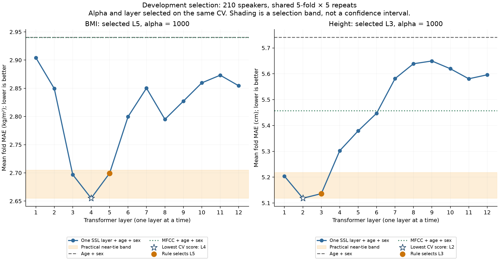

# 12層開發CV比較

每層只使用自己的768維WavLM特徵＋年齡、性別；人口OLS不懲罰。兩目標使用相同210人與25組分折，各target／layer獨立選alpha。MAE越低越好。

| 層 | BMI MAE（kg/m²） | BMI alpha | 身高 MAE（cm） | 身高 alpha |
|---|---:|---:|---:|---:|
| 1 | 2.904267 | 10000 | 5.203944 | 1000 |
| 2 | 2.849361 | 1000 | 5.118461 | 1000 |
| 3 | 2.696852 | 1000 | **5.136168** | 1000 |
| 4 | 2.655025 | 1000 | 5.302278 | 1000 |
| 5 | **2.699296** | 1000 | 5.379083 | 1000 |
| 6 | 2.799612 | 1000 | 5.447254 | 1000 |
| 7 | 2.850252 | 1000 | 5.581295 | 1000 |
| 8 | 2.794929 | 1000 | 5.638817 | 10000 |
| 9 | 2.827105 | 1000 | 5.649477 | 10000 |
| 10 | 2.859569 | 1000 | 5.619521 | 10000 |
| 11 | 2.873200 | 1000 | 5.580614 | 10000 |
| 12 | 2.854488 | 1000 | 5.596049 | 1000 |

粗體為依預先規則選定的層，並非原始最低分。

| 目標 | 原始最低層／MAE | 近似平手候選 | 選定層／MAE | 人口基準MAE | 對人口基準差值 | 勝／平／負 |
|---|---|---|---|---:|---:|---|
| bmi | 4／2.655025 | 3, 4, 5 | 5／2.699296 | 2.940111 | -0.240814 | 22／0／3 |
| height_cm | 2／5.118461 | 1, 2, 3 | 3／5.136168 | 5.740503 | -0.604335 | 23／0／2 |

近似平手帶固定為BMI最低分＋0.05 kg/m²、身高最低分＋0.10 cm；從帶內候選選最接近第6層，同距離選較低層。這是實務選擇規則，不是信賴區間或統計等效；第6層偏好不代表中層一定較好。

同一CV同時選alpha與layer，分數有樂觀偏差。各fold重疊，勝負次數與標準差只描述，不當成獨立樣本推論。test135人尚未評估。
