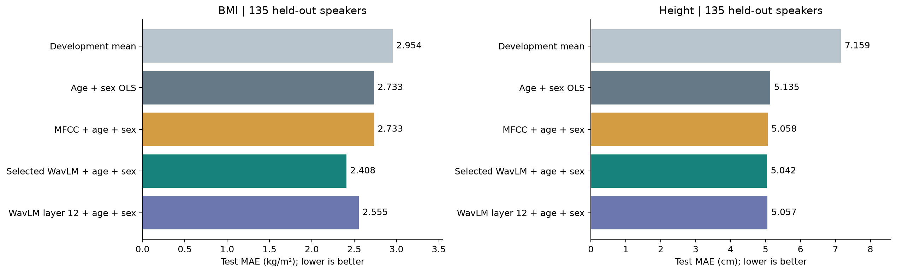
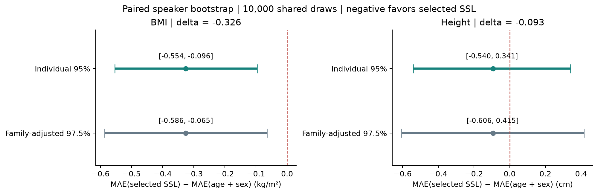
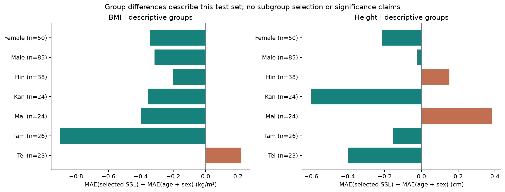

# NISP 正式 test：BMI 與身高

完成日期：2026-10-05。本次在本機 CPU 完成完整選層置換、最終210人重訓、135人單次test、10,000次成對bootstrap與固定群組分析；未使用國網或GPU。既有開發結果、程式與設定均保留。

## 結果與可支持的結論

BMI：選定第5層 WavLM＋人口資訊的test MAE為2.407814 kg/m²，人口OLS為2.733386，誤差降低0.325572（約11.9%）。個別95%區間與預先鎖定的兩目標門檻都支持改善。這支持「在NISP既有資料與切分下，選定語音表徵提供年齡、性別之外的BMI預測資訊」。

身高：選定第3層的MAE為5.042051 cm，人口資訊為5.135488，降低0.093436 cm；兩種區間都跨0，不能確認額外增益，也不能據此證明語音不含身高資訊。身高作為對照只提供有限證據，不能單憑它判定流程有錯。

BMI開發CV增益0.240814在test未縮小；身高則從0.604335縮至0.093436。CV經過layer／alpha選擇，且與test的樣本、訓練人數不同，不直接比較兩者絕對MAE。正式泛化表現以本次鎖定test為準。

NISP的BMI由身高、體重計算，**不是體脂率**。這些結果不能等同體脂率估計成功。母語、通道、錄音條件等仍可能解釋部分關聯；不作因果或層的生理解讀。

## 五模型完整成績

全部以相同210人重訓，135人test不參與fit、標準化、alpha或選層。人口OLS含截距、年齡及性別，不受懲罰；音訊模型在開發資料標準化，對目標與特徵雙殘差化，只懲罰語音係數。每次只用一層768維，MFCC是26維。

BMI選定L5 α=1000、MFCC α=10^12、L12 α=1000。身高選定L3 α=1000、MFCC α=100、L12 α=1000。BMI的MFCC在大alpha下幾乎退回人口基準，表格同值是預期行為。

| 目標 | 模型 | MAE ↓ | RMSE ↓ | R² | n |
|---|---|---:|---:|---:|---:|
| BMI（kg/m²） | 開發集平均值 | 2.954009 | 3.607292 | -0.019515 | 135 |
| BMI（kg/m²） | 年齡＋性別 OLS | 2.733386 | 3.388704 | 0.100299 | 135 |
| BMI（kg/m²） | MFCC＋人口資訊 | 2.733386 | 3.388704 | 0.100299 | 135 |
| BMI（kg/m²） | 選定層 WavLM＋人口資訊 | 2.407814 | 3.091019 | 0.251427 | 135 |
| BMI（kg/m²） | 第12層 WavLM＋人口資訊 | 2.554834 | 3.230120 | 0.182536 | 135 |
| 身高（cm） | 開發集平均值 | 7.158787 | 8.479606 | -0.001621 | 135 |
| 身高（cm） | 年齡＋性別 OLS | 5.135488 | 6.411265 | 0.427415 | 135 |
| 身高（cm） | MFCC＋人口資訊 | 5.058448 | 6.278584 | 0.450869 | 135 |
| 身高（cm） | 選定層 WavLM＋人口資訊 | 5.042051 | 6.316105 | 0.444287 | 135 |
| 身高（cm） | 第12層 WavLM＋人口資訊 | 5.056882 | 6.271007 | 0.452194 | 135 |

完整指標CSV（本機研究產物，未隨儲存庫分發）；逐人實際值與五模型預測（本機研究產物，未隨儲存庫分發）。

## 預先指定的主要比較

Δ=MAE（選定SSL＋人口）−MAE（人口），負數代表較低誤差。10,000次以speaker為單位成對重抽樣，所有模型和兩目標共用同一組10,000×135索引。個別95%使用2.5%～97.5%分位數；兩目標家族採每個97.5%雙側區間（1.25%～98.75%分位數），上界小於0才通過多重比較門檻。這是bootstrap近似，不保證精確有限樣本涵蓋率。

| 目標 | ΔMAE：SSL−人口 | 個別95% CI | 家族調整97.5% CI | 通過兩目標門檻 |
|---|---:|---|---|---|
| BMI（kg/m²） | -0.325572 | [-0.553988, -0.096331] | [-0.586154, -0.064843] | 是 |
| 身高（cm） | -0.093436 | [-0.539903, 0.341379] | [-0.606026, 0.415182] | 否 |

區間以已擬合模型及本test人群為條件，未涵蓋重新訓練、完整選擇或新資料來源的不確定性。既有25折重複CV彼此重疊，不用折分數的SE作正式不確定性。

## 全部事先指定的次要比較

以下95%區間只作描述，不增加確認性家族結論。

| 目標 | 比較（候選−參考） | ΔMAE | 95% CI（描述） |
|---|---|---:|---|
| BMI（kg/m²） | 選定層 WavLM＋人口資訊 − MFCC＋人口資訊 | -0.325572 | [-0.553988, -0.096331] |
| BMI（kg/m²） | 第12層 WavLM＋人口資訊 − 年齡＋性別 OLS | -0.178552 | [-0.368701, 0.006626] |
| BMI（kg/m²） | 選定層 WavLM＋人口資訊 − 第12層 WavLM＋人口資訊 | -0.147020 | [-0.297259, 0.007031] |
| 身高（cm） | 選定層 WavLM＋人口資訊 − MFCC＋人口資訊 | -0.016397 | [-0.368959, 0.336965] |
| 身高（cm） | 第12層 WavLM＋人口資訊 − 年齡＋性別 OLS | -0.078606 | [-0.473450, 0.309317] |
| 身高（cm） | 選定層 WavLM＋人口資訊 − 第12層 WavLM＋人口資訊 | -0.014830 | [-0.301585, 0.270493] |

BMI第12層相對人口、選定第5層相對第12層的區間都跨0，不能把第5層的較低點估計解讀成它確定優於第12層或具有特定生理意義。身高三個音訊模型近似，沒有可靠的勝負證據。

全部8組比較（本機研究產物，未隨儲存庫分發）；完整抽樣索引與分布（本機研究產物，未隨儲存庫分發）。

## 開發資料的完整選擇置換

每目標性別內打亂標籤99次，每次完整重跑12層×16個alpha×原25折，重擬人口基準，沿用原近似平手及選層規則。identity欄重現既有24個target×layer成績、alpha及選層。此處增益=人口MAE−選定SSL MAE（正數較好），與test的Δ符號相反。

| 目標 | 真實CV增益 | 置換97.5%分位 | 置換最大增益 | ≥真實增益次數 |
|---|---:|---:|---:|---:|
| BMI | 0.240814 | 0.044426 | 0.106127 | 0/99 |
| 身高 | 0.604335 | 0.144246 | 0.563402 | 0/99 |

真實增益都超過本次置換分布，但身高一次0.563接近真實0.604。性別內置換會破壞年齡與目標的關聯，這是選擇偏差診斷，**0/99不是正式條件式p值或訊號來源的證明**。它不能保證test成功，本次身高縮水也說明此限制。未據置換結果改任何設定。

[置換報告與完整hash證據](../selection-permutation-v1-20261005/REPORT.md)。

## 固定分組描述

Female/Male各50/85人；母語群代碼Hin/Kan/Mal/Tam/Tel各38/24/24/26/23人。所有錄音仍為英文，這是說話者群組，而非錄音語言比較。Δ=選定SSL−人口。

| 群組 | n | BMI 人口 MAE | BMI SSL MAE | BMI Δ | 身高 人口 MAE | 身高 SSL MAE | 身高 Δ |
|---|---:|---:|---:|---:|---:|---:|---:|
| Female | 50 | 2.945001 | 2.602397 | -0.342603 | 5.276521 | 5.063274 | -0.213247 |
| Male | 85 | 2.608906 | 2.293353 | -0.315554 | 5.052527 | 5.029567 | -0.022960 |
| Hin | 38 | 2.434567 | 2.234250 | -0.200317 | 5.140050 | 5.292494 | 0.152444 |
| Kan | 24 | 2.266234 | 1.912073 | -0.354162 | 6.595951 | 5.996454 | -0.599497 |
| Mal | 24 | 2.760134 | 2.362121 | -0.398013 | 5.016354 | 5.400574 | 0.384220 |
| Tam | 26 | 3.117782 | 2.220336 | -0.897446 | 4.915781 | 4.759115 | -0.156666 |
| Tel | 23 | 3.252101 | 3.471476 | 0.219375 | 3.976666 | 3.578108 | -0.398558 |

BMI在兩性點估計均改善，母語五群中四群改善、Tel群較差0.219；Tam群加權改善約0.173 kg/m²，占總改善約53%。身高Hin/Mal較差，其他三群較好。這些只描述既有test，小群23～38人，不作分組顯著性、不挑模型、不排除群組。

群內點估計不能排除錄音環境、通道與目標的相關，也不代表跨語言群泛化已驗證。NISP包含身體資訊與多語群資料（[官方資料集](https://github.com/iiscleap/NISP-Dataset)）；WavLM為多種語音任務學習表徵，並不保證只保留身體資訊（[原始論文](https://arxiv.org/abs/2110.13900)）。

全部70筆分組結果（本機研究產物，未隨儲存庫分發）。

## 散點圖

每個panel都是相同135人。BMI的SSL預測較人口基準分散，高BMI仍常被低估；視覺較分散不代表校準完整。身高也有向群體平均收縮的現象。本階段沒有因圖形新增log目標、截斷或其他test後調參。

個人散點圖未隨儲存庫分發；僅保留集計摘要。

## 先預測、後開啟目標的證據

1. fit前保存[正式設定v2](../../configs/official_test_v2.json)與test前預期（本機研究產物，未隨儲存庫分發）。設定SHA-256：`52e9ff6927d9d0da57e4c29ffd821a11eab9472c38c551214a1094cb506ced21`。
2. 準備只含speaker_id/split/age/sex/language的predictors.csv，及只有210個dev目標的development_targets.csv。準備階段讀原CSV字串，但不解析或投影test的BMI／身高。預測只讀分離輸入及驗證後NPZ，不開啟原含test目標的CSV。
3. fit前保存source/input/reference lock；保存270筆無目標預測，再核對135人ID、順序、欄位、有限值和範圍，沒有截斷或排除。
4. 預測SHA：`ea36176f6e49149733e73547dffce166d2ad2087e386556f6e813378c71e6249`。保存的預測（本機研究產物，未隨儲存庫分發）、主線計分前核對（本機研究產物，未隨儲存庫分發）。
5. 計分前驗證預測、audit、config、source、input與開發參考hash，再驗證目標原檔hash並保存score_lock，才解析test目標。score無fit、選擇或覆寫。
6. 計分鎖（本機研究產物，未隨儲存庫分發） SHA：`426fda006656da8d747be141cbac887d22dd1bcefb9abc0c7791ec420359fbe5`；預測鎖（本機研究產物，未隨儲存庫分發） SHA：`4e48519f856876c7148373ee8616e1ee9d887573dbdb2bc173fc9f75d9762ff9`。

獨立tester重新計算270筆對齊、10指標、8比較、固定seed完整索引及70分組，與原輸出最大差異0；原目標與scored actuals逐項相同，hash chain全部通過。獨立驗證紀錄（本機研究產物，未隨儲存庫分發）。

置換專用7測試、正式test專用9測試均通過，含保護test目標、hash失敗時禁止target loader、n<p Ridge獨立lstsq oracle、完整toy prepare→predict→score與全部輸出數量。唯讀source審查無blocker，既有source及鎖定結果未改寫。

## 保存與後續

正式test已使用一次。新模型或調整需新的評估安排，不能反覆拿這135人選設定後宣稱新的無偏成績。下一步優先整理本結果進專題的資料、方法、結果與限制章節；若檢驗母語／環境解釋，應另立開發資料內的群組控制或跨群評估規劃。實際體脂率資料取得後再建立獨立體脂率實驗。

原研究另保存圖表；本儲存庫僅分發集計圖，不分發個人散點圖。[圖表程式](../../render_nisp_official_test.py)只讀保存結果，不fit或選模型。無須再配置GPU或重訓來核對本次成績。輸出hash清單見delivery_manifest.json。
