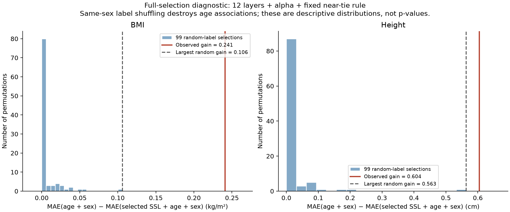

# 完整選層流程的開發資料置換檢查

99次性別內標籤置換，BMI與身高各自使用固定SeedSequence子亂數流。每次重擬人口OLS、重選12層各自的16個alpha，再套原近似平手規則；全部沿用相同210人與25-fold。正式test目標未解析。

增益定義為人口基準MAE－選定SSL＋人口模型MAE，正值代表語音模型誤差較低。

| 目標 | 真實開發增益 | 置換增益中位數 | 置換增益97.5%分位數 | 置換最大增益 | ≥真實增益的次數 |
|---|---:|---:|---:|---:|---:|
| bmi（kg/m²） | 0.240814 | -0.000000 | 0.044426 | 0.106127 | 0/99 |
| height_cm（cm） | 0.604335 | -0.000000 | 0.144246 | 0.563402 | 0/99 |

中位數極接近0，顯示多數置換由大alpha退回人口基準；約10⁻⁹的負值屬有限大alpha與數值精度，不當成實質惡化。兩個真實增益都超過本次99個置換的最大值；但身高有一次0.563 cm的隨機增益，接近真實0.604 cm，不能忽略這個尾端例子。



這個診斷支持進行預先鎖定的正式test，沒有因此改變BMI第5層、身高第3層與alpha1000。性別內置換雖保留性別分布，仍破壞年齡與目標關聯，因此不把tail count或其比例當成嚴格的條件式p值，不聲稱證明無洩漏、因果或必然泛化成功。

## 驗證與保存

原標籤identity column完整重現前輪24個層／目標的alpha、mean-fold MAE、人口MAE、選定層與增益。7項focused tests驗證批次與逐次計算一致、置換只在性別內、每次重新選層／alpha、人口增益重現以及失敗時停止診斷輸出。

每折每層只分解一次特徵矩陣，200個目標欄位包括兩target的真實＋99次置換；目標回歸係數與人口基準仍分別重新計算。600筆大alpha檢查各覆蓋100個標籤欄位，共60,000個target×layer×fold×label-column檢查均通過。

保存`search_fold_mae.npz`（2×100×12×25×16 MAE cube、人口baseline、全部mapping及dev labels）、200列`selection_permutations.csv`、`mapping_hashes.json`、`observed_reproduction.json`、`nesting_checks.json`、`protocol_lock.json`與`independent-verification.json`。主線從cube獨立重選所有alpha／layer與計算增益，最大差2.7×10⁻¹⁵；mapping、來源與reference hashes都一致。沒有新擬合或test評估。

## 重現

從track2-nisp目錄執行，指定不存在的新output：

```bash
env OMP_NUM_THREADS=4 OPENBLAS_NUM_THREADS=4 MKL_NUM_THREADS=4 \
  .venv-tests/bin/python evaluate_nisp_selection_permutation.py \
  --features results/stage1-20261004T092357Z/features \
  --config configs/selection_permutation_v1.json \
  --layer-reference results/layers-cv-v2-20261005 \
  --baseline-reference results/baselines-height-cv-v1-20261004 \
  --prior-cv results/bmi-cv-v2-20261004 \
  --output results/selection-permutation-reproduction
```

後續遵守已鎖定的`configs/official_test_v2.json`：先以210人擬合五模型、保存不含test目標的預測與hash，再驗證後併入135人test標籤，最後成對bootstrap與描述性分組。預先預期見`../../reports/PRE_TEST_EXPECTATIONS.md`。
